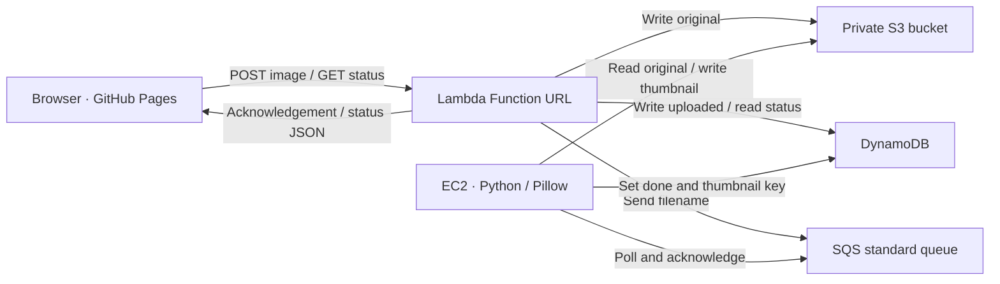

# System architecture

1. The browser encodes the image as base64 and sends JSON to the Lambda Function URL.
2. Lambda decodes the bytes, writes `uploads/<filename>` to S3, stores `status=uploaded` in DynamoDB and sends the filename to SQS.
3. The EC2 worker polls SQS. It uses the filename to download the original from S3, resize it with Pillow and write `thumbnails/<filename>` back to S3.
4. The worker updates the DynamoDB item to `done` and deletes the SQS message after processing succeeds.
5. The browser polls Lambda by filename. Lambda reads DynamoDB and returns the current status. The UI maps `uploaded` to **Queued** and `done` to **Done**.

IAM roles authorize Lambda and EC2 to call the AWS services. The image bytes travel through S3. SQS carries the job reference.
